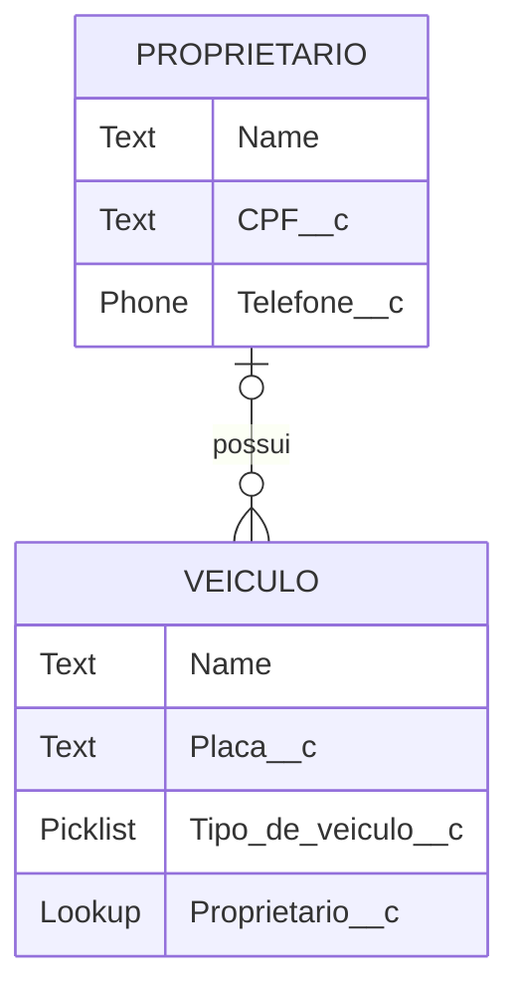

# Gestão de Veículos e Proprietários | Salesforce

Projeto de estudo e portfólio desenvolvido na plataforma Salesforce para organizar veículos e seus proprietários. Explora modelagem de dados, objetos personalizados e relacionamentos, com metadados versionados em Git na estrutura Salesforce DX.

## Objetivo

Centralizar as informações de veículos e seus responsáveis, permitindo associar vários veículos a um mesmo proprietário. Esta primeira etapa entrega o modelo de dados da solução.

## Funcionalidades implementadas

- Cadastro de proprietários: nome, CPF e telefone.
- Cadastro de veículos: nome, placa, tipo e proprietário.
- Placa única, sem diferenciação entre maiúsculas e minúsculas.
- Tipo de veículo obrigatório: Caminhão, Carreta, Moto, Van ou Utilitário.
- Relacionamento Lookup entre Veículo e Proprietário.
- Visualização de lista **Tudo** em cada objeto e objetos habilitados para relatórios.

## Modelo de dados



### Proprietário — `Proprietario__c`

| Campo | Nome de API | Tipo | Regra atual |
| --- | --- | --- | --- |
| Nome | `Name` | Texto | Identificação do registro |
| CPF | `CPF__c` | Texto (11) | Opcional; sem unicidade ou validação dos dígitos |
| Telefone | `Telefone__c` | Telefone | Opcional |

### Veículo — `Veiculo__c`

| Campo | Nome de API | Tipo | Regra atual |
| --- | --- | --- | --- |
| Nome | `Name` | Texto | Identificação do registro |
| Placa | `Placa__c` | Texto (7) | Opcional e única; sem validação de formato |
| Tipo de veículo | `Tipo_de_veiculo__c` | Lista de opções | Obrigatório; valores restritos |
| Proprietário | `Proprietario__c` | Lookup | Vínculo opcional com `Proprietario__c` |

Um proprietário pode ter zero ou vários veículos. Cada veículo pode estar associado a um proprietário ou permanecer sem vínculo. Ao excluir um proprietário, o relacionamento é limpo e o veículo permanece cadastrado (`SetNull`).

## Tecnologias e conhecimentos praticados

- **Salesforce Platform:** objetos, campos personalizados e relacionamento Lookup.
- **Salesforce DX e Salesforce CLI:** organização e transporte dos metadados.
- **VS Code:** desenvolvimento com extensões Salesforce.
- **Git e GitHub:** versionamento e publicação do projeto.

A versão de API configurada é **68.0**. As configurações de Jest, ESLint e Prettier vêm do template Salesforce DX. Esta etapa ainda não contém componentes LWC, classes Apex de negócio ou testes automatizados.

## Estrutura do repositório

```text
force-app/main/default/objects/
├── Proprietario__c/
│   ├── fields/
│   ├── listViews/
│   └── Proprietario__c.object-meta.xml
└── Veiculo__c/
    ├── fields/
    ├── listViews/
    └── Veiculo__c.object-meta.xml
config/                    # Definição de scratch org
scripts/                   # Exemplos Apex e SOQL do template
sfdx-project.json           # Configuração do projeto DX
```

## Como utilizar

### Pré-requisitos

- Git e Salesforce CLI (`sf`) instalados.
- Organização Salesforce de desenvolvimento ou sandbox compatível com a API do projeto e permissão para implantar metadados.
- VS Code com extensões Salesforce, recomendado para acompanhar o código.

### Implantação em uma organização de desenvolvimento

```bash
git clone https://github.com/Ric-ardo28/salesforce-gestao-veiculos.git
cd salesforce-gestao-veiculos

sf org login web --alias gestao-veiculos
sf project deploy start --source-dir force-app --target-org gestao-veiculos
sf org open --target-org gestao-veiculos
```

Para uma sandbox, acrescente `--instance-url https://test.salesforce.com` ao comando de login. Utilize uma organização destinada a estudos.

Após a implantação, confira os objetos em **Configuração → Gerenciador de Objetos**. O repositório contém objetos, campos e listas; ainda não inclui aplicativo Lightning, abas, layouts personalizados ou conjuntos de permissões. Para disponibilizar os cadastros na navegação de um aplicativo, configure as abas e os acessos na organização.

### Roteiro de demonstração

Após configurar a navegação e os acessos:

1. Cadastre um proprietário com dados fictícios.
2. Cadastre um veículo, selecione seu tipo e associe o proprietário.
3. Cadastre outro veículo para o mesmo proprietário, demonstrando a relação de um para muitos.
4. Tente repetir uma placa preenchida para observar a restrição de unicidade.
5. Tente salvar um veículo sem tipo para observar a obrigatoriedade do campo.

O repositório versiona metadados, sem registros de negócio ou credenciais. Arquivos locais de autenticação Salesforce e variáveis de ambiente são ignorados pelo Git.

## Próximas evoluções

- [ ] Versionar aplicativo Lightning, abas, layouts e conjuntos de permissões.
- [ ] Implementar regras de validação para CPF e placa.
- [ ] Criar relatórios e painéis de acompanhamento dos veículos.
- [ ] Explorar automações com Salesforce Flow.
- [ ] Adicionar imagens da interface e evidências das validações em uma organização de desenvolvimento.

## Autor

Desenvolvido por [Ric-ardo28](https://github.com/Ric-ardo28) como projeto prático de aprendizado em Salesforce.
